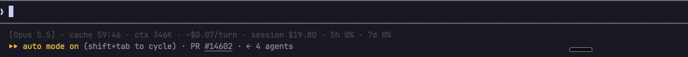

# Claude usage status line

A small Bash status-line mod for Claude Code. See the model, an estimated prompt-cache countdown, context tokens, session cost, and 5-hour / 7-day usage percentages in one line.



*The status line in a live Claude Code session.*

```text
[Sonnet] · cache 58:00 · ctx 42K · ~$0.12/turn · session $1.42 · 5h 23% · 7d 41%
```

This is the original personal script, published unchanged. It shows usage percentages, not usage bars, pace markers, or rate-limit reset countdowns.

## Requirements

- macOS. The script uses BSD `stat -f %m`; it is not Linux-compatible as written.
- Bash, `jq`, and the standard macOS command-line tools.
- Claude Code with [status-line JSON input](https://code.claude.com/docs/en/statusline). Usage percentages appear only when Claude Code supplies `rate_limits` data.

Install `jq` with Homebrew if needed:

```sh
brew install jq
```

## Install with herdr

The herdr plugin installs this mod into **Claude Code**, including Claude Code running inside herdr. It does not add a native herdr status bar. The renderer stays unchanged.

Requires herdr 0.7.5 or later on macOS, plus the requirements above.

1. Install the plugin:

   ```sh
   herdr plugin install akhilnalliboina/claude-usage-statusline
   ```

   Installing registers the plugin. It does not change Claude Code settings or run setup automatically.

2. Run its explicit setup action from a running herdr session:

   ```sh
   herdr plugin action invoke akhilnalliboina.claude-usage-statusline.setup
   ```

   The action copies the script to `~/.claude-personal/statusline.sh` and replaces only the `statusLine` property in your Claude Code settings. It preserves all other settings.

   The action reads `CLAUDE_CONFIG_DIR` from the herdr server's environment, not necessarily from the shell invoking the action. For a custom configuration directory, the simplest option is to clone this repository and run setup directly from the checkout:

   ```sh
   CLAUDE_CONFIG_DIR="$HOME/.claude-work" bash scripts/setup.sh
   ```

3. Inspect the action log for the settings, script, and backup paths:

   ```sh
   herdr plugin log list --plugin akhilnalliboina.claude-usage-statusline
   ```

   Start or restart Claude Code to use the status line.

Setup backs up both existing files before replacing either one. It records absent files with `.absent` markers. Backups live in the plugin's herdr state directory under `setup-backups/`; the setup output gives the exact path. Repeating setup with an identical script and setting makes no changes and creates no extra backup.

Setup rejects invalid JSON, non-object settings, symlinks, and non-file targets. Close other settings editors before running it. Each file replacement is atomic, but replacing the two files is not one transaction; use the backup to recover from a partial failure.

## Install manually

1. Clone this repository and copy the script to its expected location:

   ```sh
   git clone https://github.com/akhilnalliboina/claude-usage-statusline.git
   mkdir -p "$HOME/.claude-personal"
   cp claude-usage-statusline/statusline.sh "$HOME/.claude-personal/statusline.sh"
   chmod +x "$HOME/.claude-personal/statusline.sh"
   ```

   If you already have a script at that path, back it up before copying.

2. Add the following `statusLine` property to `~/.claude/settings.json`. If you use a custom `CLAUDE_CONFIG_DIR`, edit its `settings.json` instead. Merge this with your existing settings; do not replace the whole file. Back up an existing `statusLine` property if you want to restore it later.

   ```json
   {
     "statusLine": {
       "type": "command",
       "command": "bash \"$HOME/.claude-personal/statusline.sh\"",
       "refreshInterval": 5
     }
   }
   ```

3. Start Claude Code. The command reads session JSON from stdin and writes one ANSI-colored line to stdout. The refresh interval lets the cache countdown update while idle.

This repository is a herdr installer plugin, not a Claude Code `/plugin install` package. The mod uses Claude Code's main `statusLine` setting: [plugin default settings](https://code.claude.com/docs/en/plugins-reference#settings) do not support the main `statusLine` property.

## What the fields mean

| Field | Meaning |
| --- | --- |
| `[Sonnet]` | Model display name supplied by Claude Code. |
| `cache 58:00` | Estimated time left in a one-hour prompt-cache window, based on the transcript file's modification time. Turns yellow in the last five minutes and red as `cache cold` after expiry. |
| `ctx 42K` | Input tokens plus cache-creation and cache-read tokens from the current usage data. `K` is rounded down to thousands. |
| `~$0.12/turn` | Last observed increase in total session cost. An approximation, not an exact per-turn billing measurement. |
| `session $1.42` | Total session cost supplied by Claude Code. |
| `5h 23%` / `7d 41%` | Percentage consumed in the 5-hour and 7-day usage windows, rounded to a whole percentage. |

Missing fields are omitted. Zero-cost sessions do not show cost fields. The cache countdown is a heuristic: transcript updates do not prove that the prompt cache is warm. The first observed cost establishes a baseline; the per-turn estimate appears after a later increase.

## Privacy and local state

The script makes no network requests and does not read credentials or transcript contents. It reads JSON from Claude Code, checks the transcript file's modification time, and stores the last observed cost values in:

```text
~/.claude-personal/state/statusline-cost-<session_id>
```

State files contain two numbers: total cost and the last observed increase. They persist until you remove them. Treat stdin as trusted Claude Code session data; this unchanged script is not a general-purpose parser for untrusted input.

The herdr setup action also stores backups of your settings and any previous script locally. These backups may contain private settings or credentials. They are not uploaded. Keep them private and delete them when you no longer need them.

## Quick check

```sh
printf '%s\n' '{"model":{"display_name":"Sonnet"},"rate_limits":{"five_hour":{"used_percentage":23},"seven_day":{"used_percentage":41}}}' \
  | bash "$HOME/.claude-personal/statusline.sh"
```

Expected text, with ANSI styling:

```text
[Sonnet] · 5h 23% · 7d 41%
```

## Remove or restore

1. Find the backup path in the setup action log. `locations.txt` records the settings and script destinations.
2. Restore the `statusLine` property from the backed-up `settings.json`, or remove it if the original settings had no `statusLine`. If `settings.json.absent` exists, there was no original settings file. Do not overwrite unrelated settings you changed after setup.
3. Restore the previous script from the backup if it exists. If `statusline.sh.absent` exists, you can delete the installed script. You can also delete this script's `statusline-cost-*` state files. Leave other files in `~/.claude-personal` intact.
4. If you installed through herdr, unregister the plugin:

   ```sh
   herdr plugin uninstall akhilnalliboina.claude-usage-statusline
   ```

Uninstalling the plugin does not restore Claude Code settings or delete the copied renderer. Restore or remove the setting first. Herdr retains plugin state; remove old backups yourself when you no longer need them.

## Development

Run the setup tests on macOS:

```sh
python3 -B -m unittest discover -s tests -v
```

The tests use temporary home directories and do not modify your Claude Code settings.

The plugin has also been tested by linking and invoking its setup action in an isolated herdr 0.9.3 server.

Test the plugin manifest locally:

```sh
herdr plugin link "$PWD"
herdr plugin action list --plugin akhilnalliboina.claude-usage-statusline
```

The setup action can also run without a herdr server, directly from a checkout:

```sh
bash scripts/setup.sh
```

Direct setup stores backups in `~/.claude-personal/state/setup-backups/` unless `HERDR_PLUGIN_STATE_DIR` is set. After local testing, unregister the link with `herdr plugin unlink akhilnalliboina.claude-usage-statusline` before installing the GitHub version.
